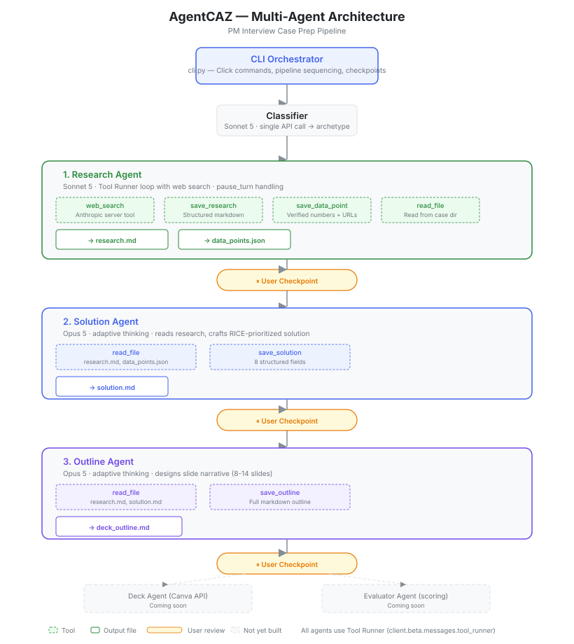

# AgentCAZ

Multi-agent system for PM interview case preparation. Automates research, solutioning, and deck planning so you can focus on presenting, not preparing.



## How It Works

AgentCAZ runs a pipeline of specialized AI agents, each with its own tools and model:

1. **Classifier** — Takes your case question and detects the archetype (improve product, build new product, enter market, strategic bet, diagnose problem, monetize asset)
2. **Research Agent** — Runs live web searches to gather company data, market sizing, competitor analysis, user segments, and user journey mapping. Produces `research.md` with sourced data points
3. **Solution Agent** — Reads the research and crafts a structured solution: problem statement, target segment, 3 feature proposals, RICE prioritization, a recommended solution pick, AARRR metrics, rollout plan, and risk analysis. Produces `solution.md`
4. **Outline Agent** — Designs a slide-by-slide deck outline with headlines, purpose, content structure, and recommended visuals for each slide. Produces `deck_outline.md`

Between each step, you can review and edit the output before continuing.

## Setup

### 1. Install dependencies

```bash
pip install -e .
```

### 2. Configure environment

Copy the example env file and add your keys:

```bash
cp .env.example .env
```

Edit `.env`:
```
ANTHROPIC_API_KEY=sk-ant-...
ANTHROPIC_WORKSPACE_ID=your-workspace-id  # only if using identity-linked keys
```

## Usage

### Full pipeline

Runs research, solution, and outline in sequence with review checkpoints between each step:

```bash
python3 run.py run -c "Spotify" -q "How would you improve Spotify's podcast discovery?"
```

Add `--auto` to skip checkpoints, or `--dev` to replay from cached responses (no API calls).

### Individual agents

Run each agent independently — useful for re-running a step after editing an earlier output:

```bash
# Research only
python3 run.py research -c "Spotify" -q "How would you improve Spotify's podcast discovery?"

# Solution only (requires research.md to exist)
python3 run.py solution -c "Spotify" -q "How would you improve Spotify's podcast discovery?" -a improve_product

# Deck outline only (requires solution.md to exist)
python3 run.py outline -c "Spotify" -q "How would you improve Spotify's podcast discovery?" -a improve_product
```

### List cases

```bash
python3 run.py list
```

### Flags

| Flag | Description |
|------|-------------|
| `-c`, `--company` | Company name (required) |
| `-q`, `--question` | Case question (required) |
| `-a`, `--archetype` | Force archetype — skips classifier API call |
| `--dev` | Replay from cached transcript, no API calls |
| `--auto` | Skip user checkpoints (full pipeline only) |

## Output Structure

```
cases/
  spotify/
    research.md          # Company context, market, competitors, users, insights
    data_points.json     # Verified numbers with source URLs
    solution.md          # Problem, proposals, RICE, metrics, rollout, risks
    deck_outline.md      # Slide-by-slide deck plan
    .cache/
      archetype.txt
      research_transcript.json
      solution_transcript.json
      outline_transcript.json
```

## Project Structure

```
AgentCAZ/
  run.py                 # Entry point
  src/
    config.py            # Model choices, paths, API client
    cli.py               # Click CLI commands and pipeline
    agents/
      research.py        # Research agent (Sonnet 5 + web search)
      solution.py        # Solution agent (Opus 5 + adaptive thinking)
      outline.py         # Outline agent (Opus 5 + adaptive thinking)
    tools/
      file_tools.py      # @beta_tool definitions for reading/writing case files
    prompts/
      classifier.md      # Archetype classification
      researcher.md      # Research process + archetype-specific focus
      solver.md           # Solution framework (RICE, AARRR)
      outliner.md        # Slide narrative design
  docs/
    architecture.svg     # Architecture diagram
  agent_architecture.md  # Detailed architecture plan
```

## Models

| Agent | Model | Why |
|-------|-------|-----|
| Classifier | Sonnet 5 | Simple classification, cost-efficient |
| Research | Sonnet 5 | High-volume web search, cost-efficient |
| Solution | Opus 5 | Strong reasoning for creative solutioning |
| Outline | Opus 5 | Narrative structure requires judgment |

## PM Frameworks Used

- **CIRCLES** — Problem decomposition (Research Agent)
- **TAM/SAM/SOM** — Market sizing (Research Agent)
- **Jobs-to-be-Done** — User need identification (Research Agent)
- **Porter's Five Forces** — Competitive analysis for market entry (Research Agent)
- **RICE** — Feature prioritization (Solution Agent)
- **AARRR** — Metrics framework (Solution Agent)

## Dev Mode

After a successful run, agent transcripts are cached in `.cache/`. Pass `--dev` to replay without API calls — useful for iterating on display formatting, tools, or downstream agents without burning tokens.

```bash
python3 run.py research -c "Spotify" -q "..." --dev
```

## Coming Soon

- **Evaluator Agent** — Scores solutions against PM interview rubrics, identifies gaps
- **Deck Agent** — Creates Canva slide decks from the outline
- **Refinement loop** — Evaluator gaps trigger targeted re-research

## Stack

- Python + [Anthropic SDK](https://docs.anthropic.com/en/docs/sdks) (Tool Runner)
- `web_search_20260209` server tool for live search
- Click CLI + Rich console output
- Local filesystem for case storage
